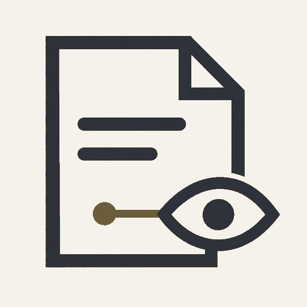
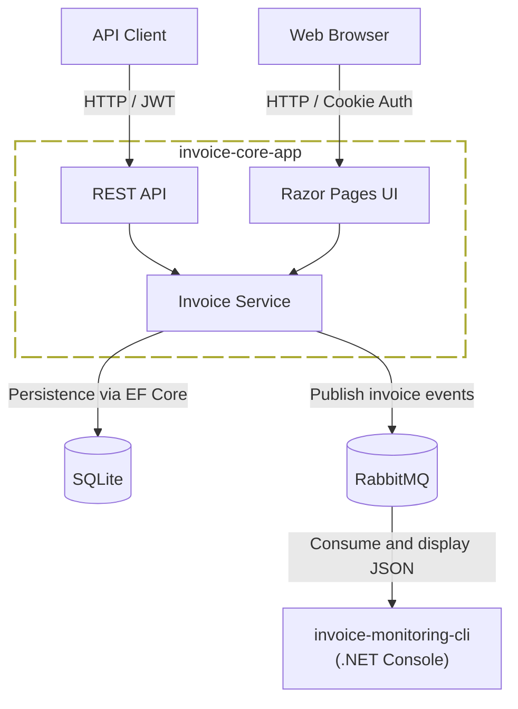

<h1> &nbsp;invoice-observer and its applications</h1>

A simple invoice management and monitoring system. An ASP.NET Core application manages invoices
and publishes events to RabbitMQ; a separate .NET console application consumes and displays them.
The two applications are developed as independent microservices.

It can serve as a monitoring component within a larger reporting or audit system.

## Key Components

| Repository | Tech | Description |
|-----------|------|-------------|
| [invoice-core-app](https://github.com/invoice-observer/invoice-core-app) | C# / ASP.NET Core / Razor Pages / EF Core | Invoice management API with JWT authentication, a Razor Pages UI with cookie authentication, SQLite persistence and RabbitMQ event publishing |
| [invoice-monitoring-cli](https://github.com/invoice-observer/invoice-monitoring-cli) | C# / .NET / RabbitMQ | Console application consuming invoice events from CloudAMQP or local RabbitMQ and pretty-printing JSON payloads for monitoring and auditing |

## Architecture Overview

## License

The invoice-observer is licensed under the terms of the [MIT License](https://github.com/invoice-observer/.github/blob/main/LICENSE).

## Contact

Eduard Danziger

[https://github.com/eduarddanziger](https://github.com/eduarddanziger)

[eduard.danziger@gmx.de](mailto:eduard.danziger@gmx.de)
